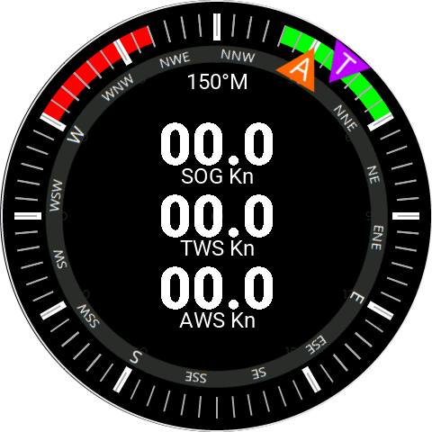
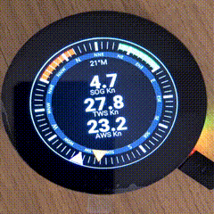

# ESPHome SignalK Component

ESPHome external component to fetch data from signalk server using websockets on arduino frameword and esp-idf framework. ESPHome is an open-source project that allows you to easily create custom firmware for ESP32 microcontrollers to integrate with home automation systems like Home Assistant. It uses a simple YAML-based configuration file to define how your device should behave.

This component allows you to connect your esp device to your signalk server. It has support to subscribe signalk paths as well as to push data to the server. The fetched data can be displayed on a custom navigational instrument made by the LVGL library, as well to activate actuators, relays etc. Also values that you get from your sensors on the esp device can easily be pushed back to the server using the signalk.publish_delta action.

The component supports esp-idf framework as well as esp arduino framework. It is also possible to use this component locally using the host: component, ESPHome will built a local binary, which you can run on your computer. No more lengthy compile process and uploading to an ESP32 device. Makes LVGL development much smoother. This has been tested with Ubuntu 24.04 and the LVGL library. See the example SDL.yaml for more details. 

Sample wind instrument view showing apparent wind angle, true wind angle, speed over ground (SOG), true wind speed (TWS), apparent wind speed (AWS) and magnetic heading using LVGL graphics library. For more information see my other project [SignalK_ESPHome_LVGL](https://github.com/batuakan/SignalK_ESPHome_LVGL)





## Installing

If using homeassistant esphome addon, just link to this repo as an external component, this will allow use of esp-idf and arduino frameworks.

Otherwise install esphome into a virtual python environment and build your project using esphome run nameofyaml.yaml

To run on local machine, ix::websockets library is required, whoch should be installed system wide, or in a path where platformio can locate it.

The component uses ESPHome's own ArduinoJson (the `json` component is loaded automatically, you do not need to add `json:` to your YAML). Do not pin ArduinoJson yourself, ESPHome picks the version.

## Known issues and limitations

1. This component will not work with SSL, if you signalk server is sitting behind an SSL connection esp32 wont be able to connect to it yet.

2. If you use the signalk component and dont define any signalk sensors, you will get a compile error saying sensor.h was not found. Just add a sensor even if you dont use it.

```ỳaml
sensor:
  - platform: signalk
    id: environment_wind_angleApparent
    path: environment.wind.angleApparent
```

## Usage

### Connecting to the server

Connecting to the server can be achieved with the following configuration. If username and password is present the client will connect to the server using username and password, Otherwise connection and access validation will be performed through access request process.

```yaml
# Fetch ESPKHomeSignalK component from github
external_components:
  - source: github://batuakan/ESPHomeSignalK@main
    components: [ signalk ]

# Setup SK instance
signalk:
  host: 10.10.10.1 # Ip address for your server
  port: 3000 # Optional Port for signalk, defaults 3000
  username: "yourusername" #optional
  password: "yourpassword" #optional
```

#### Access requests

Without a username and password the device asks the server for access (read/write) and waits until you approve it in the SignalK admin UI under *Security → Access Requests*. The token it then receives is kept in flash.

- The request is kept in flash too, so a device that restarts while waiting keeps asking for the same request. SignalK refuses a second request from a device while its first one is pending.
- If the server has forgotten the request (it keeps them for an hour, and not across a restart), the device sends a new one. Approve the newest entry.
- If a request is refused anyway (for example after updating from a version that did not keep it), the log says `Access request refused` and the device tries again every 30 seconds. Approve or deny the earlier request: the next try is then accepted and shows up as a new request to approve.

#### Finding the server automatically (mDNS)

`host` is optional. If you leave it out, the component looks for the server on your network with mDNS (signalk-server announces itself as `_signalk-http._tcp`, or `_signalk-https._tcp` with SSL turned on, see [HTTPS and WSS](#https-and-wss)) and uses the address and port it finds, so `port` is ignored in that case.

```yaml
signalk:
  username: "yourusername" #optional
  password: "yourpassword" #optional
```

- The search is repeated every second until a server is found, the log shows `Found SignalK server ...`. It works on ESP32 (both frameworks, through ESPHome's `mdns` component, which is loaded automatically and must not be disabled) and for the `host:` build on your computer. Only IPv4 is used.
- If several servers answer, the main server with the lowest address and port is used, and a warning lists how many were found. Set `host` to choose another one.
- The server found is kept in flash (an ESPHome preference, next to the token), and after a restart only that server is accepted, so the token never goes to another one.
- If the connection is lost, the same server is looked up again for 10 seconds, in case it has a new address; servers that are not the same one are ignored. After that the last known address is tried. The search starts only once the network is up, so a normal boot doesn't search at all.
- The same server is recognised by, best first: its address and port (with the same host name or vessel id: another machine can get the address), its mDNS host name and port, or only its vessel id. The vessel id alone is not proof, since every server of a vessel has it (a second server on board, or one started with a copied configuration). Such a server is only tried: it isn't saved until it accepts the token, and if it refuses it the token is kept, that server is skipped, and the bound server is looked for again.
- Discovery trusts your network: the login credentials or the access request go to whatever server answers, over plain HTTP unless the server has SSL turned on. On a network you do not control, set `host` explicitly, and turn SSL on in the server.

#### Forgetting the server

To move a device to another server, the `signalk.forget_server` action drops the server and its token. The device then looks for a server again and asks it for access. When `host` is set, it only forgets the server's pinned certificate (see below), and with plain HTTP it does nothing. On a node without a display, a button can call it:

```yaml
button:
  - platform: template
    name: "Forget SignalK server"
    on_press:
      - signalk.forget_server: signalk_main  # the id of your signalk: block
```

#### HTTPS and WSS

With *SSL* turned on in the server (*Server → Settings*), signalk-server serves HTTPS and WSS on its SSL port (3443 by default), answers its plain port only with a redirect, and announces itself as `_signalk-https._tcp`. The component then talks to it over TLS:

- With mDNS (no `host`), servers with SSL are looked for as well, and preferred. Nothing to configure.
- With `host`, set `tls: true` and the SSL port:

```yaml
signalk:
  host: 10.10.10.1
  port: 3443
  tls: true
```

- `tls: false` turns it off, also for mDNS (only `_signalk-http` is looked for). It needs the esp-idf framework or the `host:` build; on the Arduino framework only plain HTTP is used.

The server's certificate is one it made for itself: self-signed, named `localhost`, signed with SHA-1. No certificate authority vouches for it and its name never matches the server's address, so the component **pins** it instead: the first connection trusts the certificate the server presents and keeps its SHA-256 in flash, next to the server and the token, and every connection after that must present exactly that certificate. The log shows it:

```
[I][signalk]: Pinned the certificate of SignalK server 192.168.1.20:3443, SHA-256 8B:43:46:FD:...
```

Compare it with the server's own (`openssl x509 -in ~/.signalk/ssl-cert.pem -noout -fingerprint -sha256`). The same works for a certificate from a real CA, but such a certificate is pinned too, so renewing it (every 90 days with Let's Encrypt) counts as a change.

- **Another certificate** (the server's was regenerated, or someone else answers in its place): the device stops talking to the server and keeps its token. The log shows both fingerprints. To trust the new certificate, forget the server (`signalk.forget_server`); with `host` set that forgets only the pin.
- **No way back to plain HTTP**: a server once reached over TLS is never used over plain HTTP again, so its token never travels in the clear.
- A server that turns SSL on is found again on its SSL port by its vessel id: it is tried (the token goes to it over TLS) and pinned once it accepts the token.
- Memory: each TLS connection needs about 30–40 KB for mbedTLS (its 16 KB receive buffer and its state) while it is open: the stream all the time, and each HTTP request while it runs. On boards with PSRAM, `CONFIG_MBEDTLS_EXTERNAL_MEM_ALLOC` moves that out of internal RAM. Boards without PSRAM may not have it to spare: use `tls: false` there.
- Other components that send their own requests to the server use `base_url()` and, over HTTPS, the same pin: `crt_bundle_attach = signalk->tls_attach_fn()` in an `esp_http_client` config, or `signalk::tls_trust().ca_pem()` as the CA on the `host:` build.

The token, the server and a pending access request are ESPHome preferences, on the `host:` build too (a file in `ESPHOME_PREFDIR`, by default `~/.esphome/prefs/<name>.prefs`). ESPHome's `factory_reset` erases them along with everything else.

The device id (the access request's `clientId`) comes from the chip's MAC on an ESP32. A `host:` build has no chip: its id is made from the node name (`esphome: name:`) and ESPHome's host MAC, so each build has its own id, the same after every rebuild. To run two copies of one build as two devices, give one of them another `host: mac_address:`.

### ESPHome SignalK Components

Signalk component provides the following types "core" components to send/fetch data to/from the signalk server:

1. **text_sensor** to fetch text/json based information 
2. **sensor** to access numerical data. 
3. **number** to send numerical data
4. **text** to send text data
5. **switch** creates a signalk switch

Each component must declare an id and signalk path, other optional values are:
- id: id of the sensor
- name: unique name to identify the sensor
- path: signalk path to subscribe to
- period: Default 1000
- format: Defaults to delta
- policy: Defaults to instant
- minperiod: Defaults to 200
- unit: Defines which unit the data should be converted to, default to none (No conversion).
  
Note that this compoennt doesn't know the units of the incoming value so technically it is possible to convert between unmatching values, therefore it is the developers responsiblity to check the unit of the incoming value and apply the correct unit conversion.

  Possible values are:

  `No conversion`
  none,

  `Angle`
  radians,
  degrees,
  gradians

  `Angular velocity`
  radians_per_second,
  degrees_per_second,
  degrees_per_minute,
  radians_per_second

  `Charge`
  coulumb,
  ampere_hours

  `Current`
  amperes,
  milliamperes

  `Energy`
  joules,
  kilowatt_hours

  `Flow`
  cubic_meters_per_second,
  liters_per_minute,
  liters_per_hour,
  gallons_per_minute,
  gallons_per_hour

  `Frequency`
  hertz,
  rotations_per_minute,
  kilohertz,
  megahertz,
  gigahertz

  `Length`
  meters,
  fathoms,
  feet,
  kilometers,
  nautical_miles,
  miles

  `Potential`
  volts,
  millivolts

  `Power`
  watts,
  milliwatts

  `Ratio`
  ratio,
  percentage

  `Resistance`
  ohms,
  kilo_ohms

  `Speed`
  meters_per_second,
  knots,
  kilometers_per_hour,
  miles_per_hour,

  `Temperature`
  kelvin,
  celsius,
  fahrenheit

  `Time`
  seconds,
  minutes,
  hours,
  days

  `Volume`
  liters,
  cubic_meters,
  gallons


#### Sensor Component
```yaml

# sensor for numerical data
sensor:
  - platform: signalk
    id: environment_wind_angleApparent
    path: environment.wind.angleApparent
    unit: knots

```
#### Text Sensor Component

Text sensor provides read only access to text and json based data from the SignalK server. Use text_sensor to read data that is emitted by other sources

```yaml
# text sensor for text based data
text_sensor:
  - platform: signalk
    id: name
    path: name

# use text_sensor to fetch json data and parse with the json component to extract information from it
text_sensor:
  - platform: signalk
    id: navigation_position
    path: navigation.position
    on_value:
      - lambda: |-
            json::parse_json(x, [](JsonObject root) -> bool {
                if (root["longitude"]) {
                    ESP_LOGI("json_parser", "Longitude: %f", root["longitude"].as<float>());
                    ESP_LOGI("json_parser", "Latitude: %f", root["latitude"].as<float>());
                }
                return true;
            });
```
#### Number Component

Numeric component to read/write numeric values to SignalK with meta data support.

Note: This is bit of a hack as the number component is designed in ESPHome to hold a numeric value like setting, but we can abuse that and use this component to send numeric values to SignalK using the number.set method.

```yaml

number: 
  platform: signalk
  id: test
  path: test.value
  min: 0
  max: 5000
  step: 1
  unit: "rotations_per_minute"
  meta:
    # Add your meta data here

# ---
#read the value from e.g. a sensor and forward it to signalk
on_value:
  - number.set:
      id: test
      value: !lambda "return x;"
```

#### Text Component

Similar to the number component, text is used to send/receive string data from the sinanlk server using the text.set method.

```yaml

text:
  - platform: signalk
    id: forecast_state
    path: environment.forecast.state
    mode: text
    meta:
      # Add your meta data here

# ---
#read the value from e.g. a sensor and forward it to signalk
on_value:
  - text.set:
      id: forecast_state
      value: !lambda "return x;"

```

### Meta Data

All platforms (sensor, text_sensor, switch, number and text) support [meta data](https://signalk.org/specification/1.5.0/doc/data_model_metadata.html) through the optional `meta:` block. Replicating the example on the SK specification page, you get a meta data definition shown as below.

```yaml

  meta:
    displayName: "Port Tachometer"
    longName: "Engine 2 Tachometer"
    shortName: "Tacho"
    description: "Engine revolutions (x60 for RPM)"
    units: "Hz"
    timeout: 1
    displayScale: 
      lower: 0
      upper: 75
      type: linear
    alertMethod: ["visual"]
    warnMethod: ["visual"]
    alarmMethod: ["sound", "visual"]
    emergencyMethod: ["sound", "visual"]
    zones:
      - upper: 4
        state: alarm
        message: "Stopped or very slow"
      - lower: 4
        upper: 60
        state: normal
      - lower: 60
        upper: 65
        state: warn
        message: "Approaching maximum"
      - lower: 65
        state: alarm
        message: "Exceeding maximum"

```

#### Noticing meta data changes on the server

A component can ask to be told when the meta data of a subscribed path changes, then read it again with `GET /signalk/v1/api/vessels/self/<path>/meta`:

```cpp
signalk->add_meta_listener([](const std::string &path) { /* read it again */ });
```

This is a hint and it can be missed. signalk-server sends meta deltas through the same `minPeriod` throttle as values, so with the default 200 ms about a third of them were dropped in tests, while a path's values were arriving. A meta delta can also hold only some keys. Read the meta data again now and then as well, and don't treat a delta as the full meta data.

#### How device and server meta data are merged

The meta data on the SignalK server can be newer than what is compiled into the device (for example edited in the admin UI), so **the server always wins**. On every (re)connect the device reads the current meta data of each path from the server and only sends the keys the server does not have yet. A key that exists on the server is never overwritten, even when its value differs from the one in the YAML (an empty string counts as not set, see below). If the server has no meta data for a path, everything from the YAML is sent. If the server cannot be reached, nothing is sent and the device retries after 10 seconds.

Arrays such as `zones` count as one value: if the server has `zones` for the path, the ones in the YAML are ignored. Objects such as `displayScale` are merged key by key.

#### Defaults

Keys you do not set are filled in for you, and anything you write in `meta:` replaces them:

| Key           | Default                                                                               |
|---------------|---------------------------------------------------------------------------------------|
| `units`       | The SI unit of the `unit:` option (e.g. `unit: knots` gives `m/s`), switches use `bool` |
| `supportsPut` | `true` for switch, number and text                                                    |


### Publishing deltas

In order to send data back to server use the **signalk.publish_delta** action. publish_delta action supports string, boolean and floating values. The unit field is optional, however if applied converts from the sensors unit format to the base SI format that signalk uses, e.g. if the sensor provides temperature values in celsius they will be converted to fahrenheit while being sent to the server.

A constant `value:` is sent as its own type. A lambda `value:` is sent as a number unless `type:` says
otherwise (`number`, `boolean` or `string`), because its type can't be read from the YAML:

```yaml
- signalk.publish_delta:
    path: steering.autopilot.ac10.engaged
    type: boolean
    value: !lambda "return id(lamp).state;"
```

The same `type:` option exists for `signalk.put_request`.


```yaml
sensor:
- platform: template
  name: "Test Fixed Sensor"
  unit_of_measurement: "°C"
  accuracy_decimals: 1
  update_interval: 5s
  lambda: |-
    return random_float() * 100.0;
  on_value:
    - signalk.publish_delta:
        path: "environment.temperature"
        unit: "celsius"
```

#### Meta data for published paths

`signalk.publish_delta` accepts the same `meta:` block as the platforms above. The meta data is not sent along with every delta, it is synchronised with the server once per (re)connect with the same rule as before: the server always wins, only keys the server does not have yet are sent. `units` defaults to the SI unit of `unit:`. An empty value on the server, such as the `description: ""` that the server adds to every path it learns, counts as missing.

```yaml
  on_value:
    - signalk.publish_delta:
        path: "propulsion.engine.revolutions"
        unit: "rotations_per_minute"   # meta.units defaults to Hz
        meta:
          displayName: "Tachometer"
          zones:
            - upper: 4
              state: alarm
```

See `examples/digital_engine.yaml` for a complete example.


### PUT Requests

In order make PUT requests to the server use the **signalk.put_request** action. 
put_request action supports string, boolean and floating values. Below is an example of sending a PUT request to the autopilot to adjust course 10 degrees to port.

```yaml
- button:

    widgets:
      - label:
          text: "-10"
    on_press:
      - signalk.put_request:
          path: steering.autopilot.actions.adjustHeading
          value: -10
```

### Handling PUT requests on the device

The device can also be the one that *answers* PUT requests: a PUT to a path sent by an app, a plugin
(`app.putSelfPath`) or `curl` reaches the device, which acts on it and replies with success or an error.

How signalk-server does this: when no plugin handles a path, it forwards the PUT to the WebSocket client
that publishes that path with a `$source`. The client then answers with the request id, and if no answer
comes the server replies `504` after 60 seconds. So the device has to **publish a path before it gets PUTs
for it**, again after every reconnect, because the server forgets the client when it disconnects.
`on_connect` is the place for that.

```yaml
signalk:
  id: signalk_main
  on_connect:
    # Publish (claim) the paths this device handles PUTs for.
    - signalk.publish_delta:
        path: steering.autopilot.ac10.steps
        value: 0.0
  on_put:
    - path: steering.autopilot.ac10.steps
      type: number          # string (default), number or boolean: the type of x
      # unit: degrees       # with type: number, x is converted from the SI value
      # reply: auto         # auto (default): 200 unless the automation answered; manual: see below
      then:
        - if:
            condition:
              lambda: "return std::abs(x) > 180;"
            then:
              - signalk.put_reply:
                  request_id: !lambda "return request_id;"
                  status_code: 400
                  message: "Too many steps"
            else:
              - logger.log:
                  format: "steps %.0f"
                  args: [x]
```

- `x` is the PUT value: a `float` for `type: number`, a `bool` for `type: boolean` (true/false, numbers,
  or "on"/"off"), and a `std::string` for `type: string`. A string value comes as it is; anything else
  comes as JSON. `request_id` is the request's id.
- With `reply: auto` the device answers `200` as soon as the automation has started. If the automation
  calls `signalk.put_reply` before that (as above), that answer is the one sent. Each request gets exactly
  one answer.
- With `reply: manual` the automation must answer within 60 s with `signalk.put_reply`, for example after
  a `delay` or after checking that an actuator responded. `request_id` defaults to the last forwarded PUT;
  pass it explicitly when the automation has a delay before the reply.
- A value the type can't take (e.g. `"abc"` for `type: number`) is refused with `400` without running the
  automation. A path the device has no handler for is refused with `405`.
- `switch`, `number` and `text` entities handle PUTs to their path too (their meta says `supportsPut`).
  Like any other path, they must have published once since the connection, so the server knows them. A
  value from the server (the subscription), a state change, or e.g. `switch.turn_off` in `on_connect`
  takes care of that.
- Published deltas carry `$source: esphome.<node name>`. Set `source:` under `signalk:` to change it.
  An empty string sends no `$source`, and then the server can't forward PUTs to the device.

`tools/e2e_put.sh` runs all of this against a throwaway local signalk-server, using a `host:` build of
`tests/e2e/put_host.yaml`.

## Contributing

Contributions of all kinds are welcome! Whether it's feedback, bug reports, feature suggestions, testing, or code improvements, your input helps make the project better for everyone. Feel free to open an issue or submit a pull request—every bit of help is appreciated!

If you have created something cool using this component, please let me know, we can can share a link to your project here, or add it to the examples.

### Possible new features

1. Adding support for other esphome supported hardware types, e.g. rpi pico
1. Better schema validation
